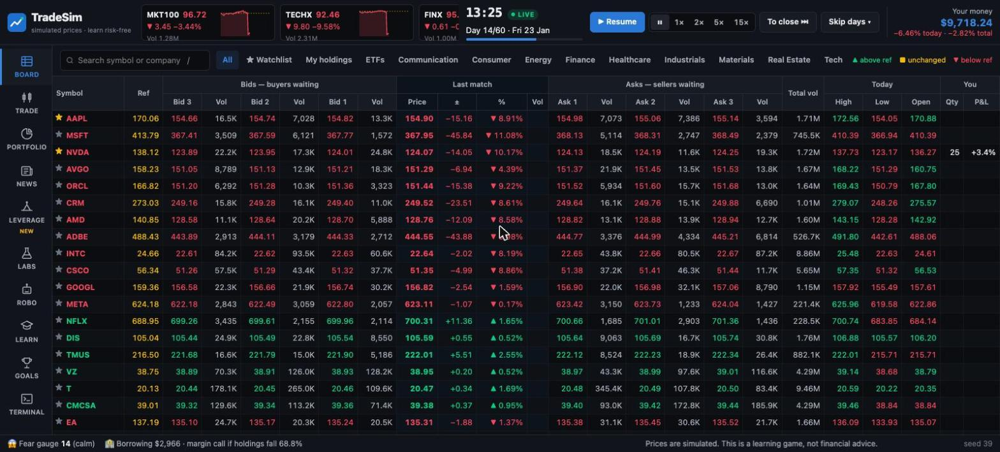
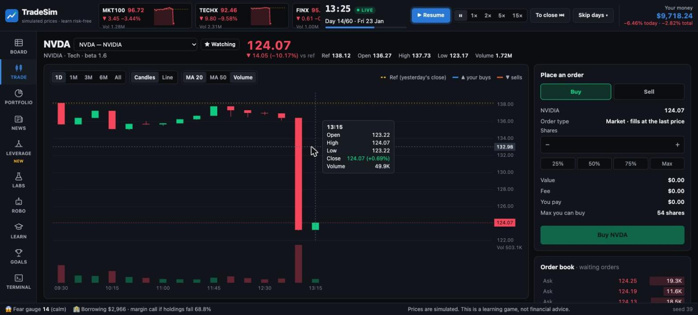
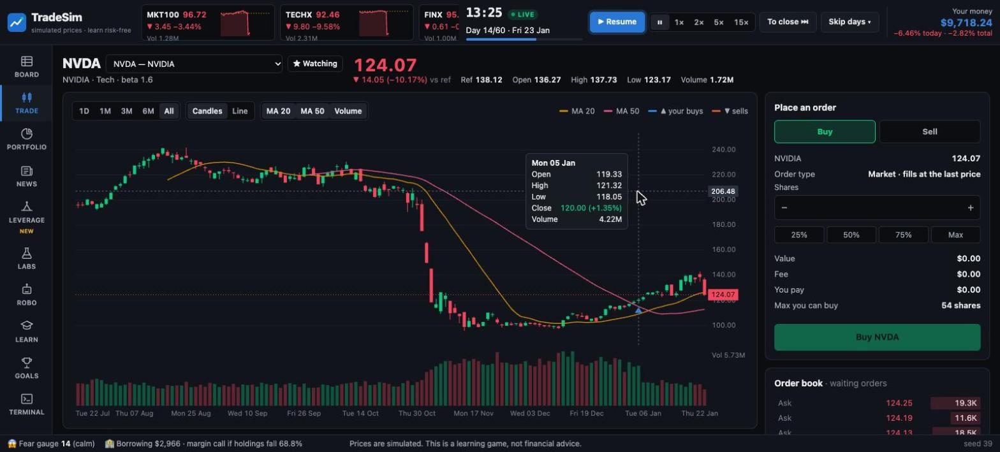
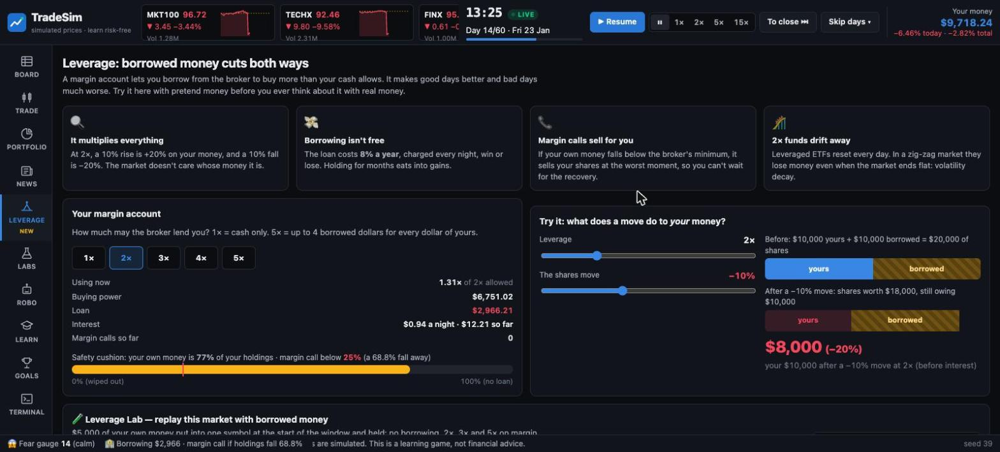

# TradeSim — learn to invest in a market that behaves like the real thing

> COMP9001 Introduction to Programming · Final Project · Semester 2 2026 · Quang (Cillian) Nguyen
>
> **All prices are simulated.** Tickers are borrowed from real companies to feel familiar,
> but no real market data is used. This is an educational game, not financial advice.

Start with **$10,000 of play money** and **60 trading days** in a live market of **100 simulated
companies in 10 sectors** plus 14 ETFs. Prices tick every five minutes from the 09:30 bell to the
16:00 close, news breaks mid-session, and the market has **hidden moods**: long bull runs 🐂,
choppy sideways spells 🦀, bear markets 🐻 and the odd crash 💥. Find out, with your own numbers,
**why spreading your money usually beats betting on one stock**, and what **borrowing to invest**
really does to you.



| Candlesticks, live (news breaks at 13:10) | Six months of history | Leverage: borrowed money cuts both ways |
|---|---|---|
|  |  |  |

## What's inside

**A live market** ([finance model §3.12](docs/03-finance-model.md))
- A broker-style **price board**: 100 stocks + 14 ETFs, reference price, three bid and ask levels,
  last match, volume, high/low/open, your position. Prices flash green ▲ or red ▼ as they tick
- The clock runs at **1×–15×** (1× = five minutes a second). Pause, **finish the day**, or **skip
  1, 5, 20 days or to the end**; a closing-bell card compares you with the market
- **Candlestick charts**: 15-minute candles for today, daily candles back **six months before the
  game starts**, moving averages, volume, your buys and sells, a crosshair tooltip
- Intraday paths are **Brownian bridges** between the daily closes: stocks move together through
  the day (scaled by beta), open with a gap, trade busiest at the open and close, and jump when news breaks

**Core (the instructor's requirements)**
- Virtual cash, buy/sell with validation, $1 fee per trade, portfolio tracking and profit/loss
  (realised + unrealised − fees = total, to the cent)
- **MIX6 ETF** priced every tick as a **weighted average** of six stocks, plus MKT100 (the whole
  market), ten sector ETFs, TECH3 (one sector) and DEF4 (defensive)

**A market that moves like real life** ([finance model §3.2](docs/03-finance-model.md))
- Hidden **market moods** from a Markov chain; **volatility clustering** (GARCH) on a VIX-style
  **fear gauge**; **beta** (NVIDIA ~1.6×, Con Edison ~0.35×); 84 headlines hitting companies, sectors
  or the whole market. The index returns ≈ +10–13%/yr with ≈ 17%/yr volatility

**Learn by playing** (the original contribution)
- **Leverage** (new) — a margin account (1×–5×): buying power, a loan with nightly interest, a
  safety-cushion bar, **margin calls** that sell for you, a "what does a move do to my money?"
  calculator, and the **Leverage Lab**: the same 60 days at 1×, 2×, 3×, 5× and in a 2× daily fund
- **Diversification Lab** — one stock vs an ETF on the same days, plus a 200-market Monte Carlo
- **News + Headline Lab (AI)** — every headline, a local AI (Laya, offline) vs a keyword counter vs what really happened
- **Trade Coach** — tips after each trade: concentration, panic selling, chasing, fees, borrowing
- **What-if Replay** — the same market replayed with 11 strategies, including yours
- **Robo-analyst (tiny ML)** — two logistic regressions in plain Python: a mood detector (≈ 85%)
  and a price forecaster (≈ 55%, barely a coin flip — that's the lesson)
- **Academy** — a 33-term glossary and a 21-question quiz; **9 challenges** (Survive the Crash,
  Margin Madness, Borrowed Bull, …) and **20 badges**

**Three ways to play** — one game engine, the same commands everywhere
- **Browser** — `uv run main.py --web`: the live price board, charts, trading, labs
- **Terminal** — `uv run main.py --seed 42`: the coloured REPL (`tick`, `leverage`, `levlab` work there too)
- **Your AI agent** — `uv run main.py buy NVDA 20`: one command per call, plain text

## Quick start

```bash
uv run main.py --web                 # browser → http://127.0.0.1:8000  (add --seed 39 for the demo market)
uv run main.py --seed 42             # terminal
uv run pytest                        # 346 tests
```
Optional, once: `uv run tools/download_model.py` (Laya AI weights, ~808 MB). Without it the
Headline Lab uses the saved answers in `data/reference.db`.

Without uv: `python3 -m venv .venv && source .venv/bin/activate && pip install -r requirements.txt -r requirements-dev.txt`,
then `python3 main.py --web`.

**First game in the browser:** press **▶ Open the market** → double-click NVDA on the board →
Buy 50% → watch it tick → **To close ⏭** → read the closing bell → try the **Leverage** page.
In the terminal: `market tech` → `buy MIX6 max` → `tick 12` → `next 5` → `leverage 2` → `levlab`.

**Where the data lives (SQLite):** `data/reference.db` is the game's content (stocks, ETFs, news,
market moods, glossary, quiz, challenges, Laya labels). It is committed, and the game opens it
read-only; edit it with `sqlite3 data/reference.db`. `saves/player.db` holds your games (git-ignored):
the web app resumes your last unfinished game when you restart it (`--seed` starts a fresh one).
Type `games` in any front end to see your results and badges.

## Let your AI agent play

```bash
uv run main.py --seed 42 market   # first call starts a seed-42 game in saves/player.db
uv run main.py buy NVDA 20
uv run main.py next 5
uv run main.py challenge crash    # or start a challenge
uv run main.py new                # start over (or --game NAME for a second game)
uv run main.py games              # your saved games, results and badges
```

> Play TradeSim, a stock-trading simulator, in this folder. Run `uv run main.py help` for the
> commands, then `uv run main.py --seed 42 market` to start. Run one command per call. Try to
> finish day 60 ahead of the MKT100 index, and explain each decision before you make it.

## Tools

| Command | What it does |
|---|---|
| `uv run tools/train_robo.py` | Retrain the Robo-analyst (after changing the price model) |
| `uv run tools/warm_cache.py` | Label new news headlines (the `event_templates` table) with Laya |
| `uv run tools/find_demo_seed.py` | Find a dramatic market for the demo (seed 39) |
| `uv run tools/verify.py cli` | Play a fixed 45-step script through agent mode → `verify-out/cli.txt` |
| `uv run tools/verify.py web` | Start the web app on port 8599 (seed 42) for browser checks |

## Documentation

| Doc | Purpose |
|---|---|
| [`docs/01-requirements.md`](docs/01-requirements.md) | What must be built and why |
| [`docs/02-architecture.md`](docs/02-architecture.md) | Stack, structure, classes, data flow |
| [`docs/03-finance-model.md`](docs/03-finance-model.md) | Formulas, the trends model, the ML maths |
| [`docs/04-features-and-cli.md`](docs/04-features-and-cli.md) | Commands, screens, web pages, edge cases |
| [`docs/05-testing.md`](docs/05-testing.md) | Test plan |
| [`docs/06-roadmap-and-demo.md`](docs/06-roadmap-and-demo.md) | Phases, demo script, scoring checklist |
| [`docs/07-decisions-log.md`](docs/07-decisions-log.md) | Decisions and open questions |
| [`docs/debug-log.md`](docs/debug-log.md) | 21 real bugs: symptom → cause → fix → test |

## Status

Phases 1–5, 8 and 9 done (core, labs, news, coach, what-if, Headline Lab, agent mode, real-life
trends, Robo-analyst, academy, challenges, badges, **the live web app with 100 stocks, candlesticks
and leverage**). Left: Phase 7 polish and the demo. The old Streamlit front end was
removed in favour of `main.py --web` (D-37, D-45).
