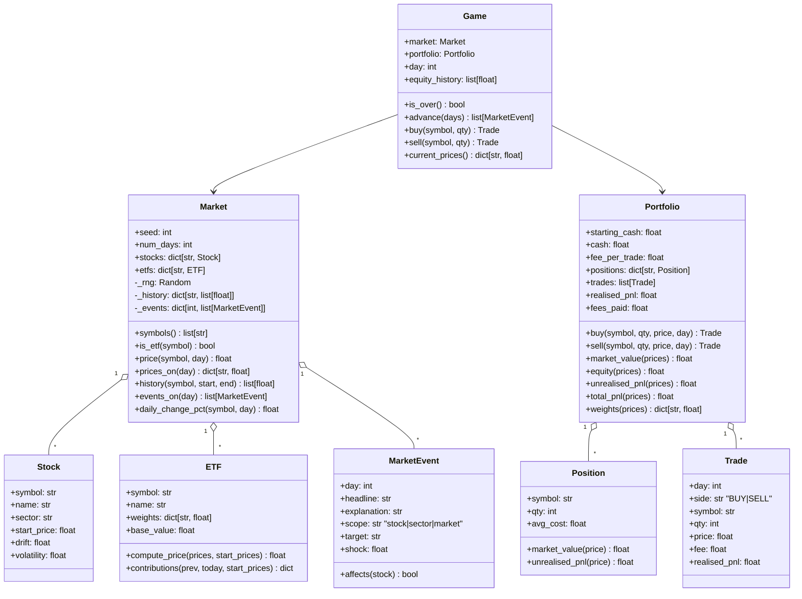

# 02 — Architecture

## 2.1 Tech stack

| Concern | Choice | Why |
|---|---|---|
| Language | Python 3.10+ | Course language; runs with `python3 main.py` |
| Terminal UI | [`rich`](https://rich.readthedocs.io) | Coloured tables, panels, green/red P&L — a much better 3-min demo for one dependency |
| Web app (D-37) | Standard-library `http.server` (JSON API) + hand-written HTML/CSS/JavaScript (ES modules) in `webapp/static/` | A real trading-app look (price board, candlesticks, live ticking) with **no new dependency** and no build step. (It replaced the Streamlit app of D-25/D-32, removed in D-45) |
| Charts | Own ASCII/Unicode line chart in `cli/charts.py`; in the browser, own canvas charts in `webapp/static/js/chart.js` (candles, volume, moving averages, crosshair) | No chart library: every pixel is code Quang can explain |
| Machine learning | Own logistic regression + gradient descent in `education/robo_analyst.py` (D-31) | No numpy/sklearn: every line is explainable and it runs anywhere |
| AI sentiment (Phase 5) | **Laya** (`convaiinnovations/laya`, open weights) run locally on the CPU via the `laya` package (D-21) | Free, offline after one download; only `tradesim/ai/` touches the model (D-20) |
| Randomness | `random.Random(seed)` | Reproducible markets (needed for replay, tests, demos) |
| Maths | `statistics` (`mean`, `stdev`), `math` | Standard library — evidences LO11 |
| Data | SQLite via `sqlite3` (D-46): `data/reference.db` (committed, read-only) + `saves/player.db` (git-ignored) | Stock universe, events, moods, glossary, quiz, challenges, AI labels; saved games and progress. Separates data from code; one small file each |
| CLI args | `argparse` | `--seed`, `--days`, `--game NAME`, `--db PATH`, plus optional command words for agent mode (D-26) |
| Tests | `pytest` (+ `pytest-cov` optional) | Readable asserts, `approx` for floats |
| Packaging | none — plain folder with `requirements.txt` | Keep it simple |

`requirements.txt`: `rich>=13`, `laya>=0.4` (pulls in torch + transformers, D-21) · `requirements-dev.txt`: `pytest>=8`, `pytest-cov>=5`, `websockets>=17.2` (only for `tools/screenshot.py`)

## 2.2 Folder structure

```
trading-sim/
├── README.md · pyproject.toml · uv.lock · requirements*.txt
├── main.py                      # entry point: REPL, agent mode, or --web (webapp.server.serve)
├── data/
│   ├── reference.db             # SQLite, committed, opened read-only (D-46): stocks (100 in 10 sectors) + etfs (14) +
│   │                            #   etf_weights, event_templates (84) + event_words, regimes + regime_next/start (D-30),
│   │                            #   challenges (9), glossary, quiz_questions, sentiment (Laya labels, E-05)
│   └── robo_model.json          # trained Robo-analyst weights (E-06, tools/train_robo.py) — stays JSON
├── tools/
│   ├── download_model.py · warm_cache.py   # Laya (E-05)
│   ├── train_robo.py            # trains both Robo-analyst models, saves data/robo_model.json
│   └── verify.py                # D-28: play a fixed CLI script / start the web app for checks
├── docs/ (01–07, debug-log, screenshots/)
├── tradesim/
│   ├── config.py                # ALL tunable constants
│   ├── database.py              # SQLite: schemas, read-only reference DB, player DB, rows → old-JSON-shaped dicts
│   ├── loader.py                # validate those dicts into engine objects (DataFileError)
│   ├── engine/                  # pure logic — NO print/input/rich
│   │   ├── errors.py · stock.py · etf.py · trade.py · position.py · portfolio.py
│   │   ├── events.py            # MarketEvent + event generation (own RNG, no quick repeats)
│   │   ├── regime.py            # Regime, RegimeModel (Markov chain of moods), spells()
│   │   ├── market.py            # Market: moods + GARCH storms + beta → every close, fear gauge,
│   │   │                        #   sessions, daily bars, order books, 120-day pre-history
│   │   ├── intraday.py          # Session + Brownian-bridge ticks, volumes, order book (D-39)
│   │   ├── margin.py            # leverage rules: credit, maintenance, margin call, liquidation (D-41)
│   │   ├── analytics.py         # returns, volatility, drawdown, moving average…
│   │   └── game.py              # Game: (day, tick) clock, step/advance, margin checks, reset()
│   ├── education/               # original features — also NO print/input/rich
│   │   ├── diversification_lab.py   # E-01 (+ Monte Carlo)
│   │   ├── explainer.py             # E-02
│   │   ├── coach.py                 # E-03 rules + sector exposure
│   │   ├── strategies.py · whatif.py   # E-04
│   │   ├── headline_lab.py          # E-05 (AI passed in as a function)
│   │   ├── robo_analyst.py          # E-06 logistic regression, training, scorecards
│   │   ├── academy.py               # E-07 glossary lookup + quiz marking
│   │   ├── achievements.py          # X-05 badges
│   │   ├── leverage_lab.py          # E-08 Leverage Lab (1×–5× margin, 2× daily fund)
│   │   └── challenges.py            # X-01 goals
│   ├── ai/sentiment.py          # the ONLY code that loads Laya (D-21)
│   ├── cli/                     # talks to the user in the terminal (rich)
│   │   ├── app.py               # dispatcher: execute / run_command / REPL run()
│   │   ├── agent.py             # X-06 agent mode
│   │   ├── savegame.py          # X-02/X-07: a game = seed + commands in saves/player.db; replay on load (D-46)
│   │   ├── parser.py            # text → Command
│   │   ├── views.py             # core screens (market, quote, portfolio, report…)
│   │   ├── insights.py          # robo, story, sectors, coach, what-if, tick, leverage screens
│   │   ├── progress.py          # badges, challenges, glossary, quiz, saved-games screens
│   │   └── charts.py            # ASCII line chart + sparkline
│   ├── webapp/                  # the web app (D-37): stdlib HTTP server + static page
│   │   ├── server.py            # routes, JSON replies, static files, 400/404/500 handling
│   │   ├── session.py           # WebSession: the game + notices (toasts) from snapshots
│   │   ├── api.py               # game → plain dicts: board, clock, account, charts, labs…
│   │   └── static/              # index.html · css/app.css · js/ (app, board, trade, chart,
│   │                            #   ticket, portfolio, leverage, pages, store, ui, api, fmt)
└── tests/                       # one test file per module (+ test_webapp.py with a real HTTP server)
```

## 2.3 Layers and dependency rule

```
          ┌──────────────────────────────────────────────┐
 user ⇄   │ cli/   app · parser · views · charts  (rich) │   only layer with print/input
          └───────────────┬──────────────────────────────┘
                          │ calls methods, catches TradeSimError
          ┌───────────────▼──────────────┐   ┌─────────────────────────────┐
          │ engine/game.py  (Game)       │◄──┤ education/  lab · explainer │
          └──────┬──────────────┬────────┘   │ coach · strategies · whatif │
                 │              │            └─────────────────────────────┘
        ┌────────▼─────┐  ┌─────▼────────┐        uses Market, Portfolio,
        │ Market       │  │ Portfolio    │        analytics (read-only)
        │ Stock · ETF  │  │ Position     │
        │ MarketEvent  │  │ Trade        │
        └──────────────┘  └──────────────┘
        config.py · loader.py · errors.py · analytics.py  (used by everything below cli)
```

**Rule:** arrows point *down* only. `engine` never imports `education` or `cli`;
`education` never imports `cli` or `web`. This makes every calculation testable without a
terminal. `webapp/`, `web/` and `cli/` sit side by side at the top: a web app changes the
game only through `cli.app.execute` (`webapp/session.WebSession.run`) and otherwise just reads
engine data (`webapp/api.py`) to draw the page (D-32, D-37).

**Web app data flow (D-37):**

```
 browser (js/app.js clock)                 server.py (one thread)          engine
 every 1/speed s ── POST /api/tick {1} ──► session.run("tick 1") ──► cli.app.execute ──► game.step()
                 ◄── {clock, account, quotes, notices…} ── api.state(session) ◄── reads Game/Market
 double-click row ─ POST /api/command {"buy NVDA 10"} ─► same path; TradeSimError → 400 {"error"}
 chart / labs ───── GET /api/chart?symbol=NVDA&span=1D ─► api.chart() (never past the current tick)
```

**AI rule (Phase 5):** `ai/sentiment.py` is the only module that touches the Laya model or
the `sentiment` tables. `education/headline_lab.py` never imports it. `cli` passes
`sentiment.classify` *in* as a function argument, and tests pass a fake one. AI output
is display-only and never feeds `Market` (D-20).

```
 cli ──passes classify──► education/headline_lab.score(headlines, classify)
  │                                   ▲
  └──imports──► ai/sentiment.classify ┘   (cache hit → no model load; no model / any error → None)
```

## 2.4 Class design



Classes added in D-29…D-33 follow the same pattern: `Regime` and `RegimeModel` (engine/regime.py),
`LogisticModel`, `Scorecard` and `RoboAnalyst` (robo_analyst.py), `Tip` (coach.py), `ReplayResult`
(whatif.py), `Badge` (achievements.py), `Challenge` and `GoalCheck` (challenges.py).
`Market` gained `regime_path`, `regime_on(day)`, `fear_index(day)`, `index_symbol()` and
`sectors()`; `Game` gained `reset()`, `challenge`, `badges`, `commands_used` and `quiz_results`.

Every class implements `__str__` (player-friendly) and `__repr__` (developer-friendly) —
both are taught in Week 7 and are easy demo talking points.

### Custom exceptions (`engine/errors.py`)

```
TradeSimError                      # base — CLI catches this one
├── UnknownSymbolError             # "XYZ is not a tradable symbol. Try: market"
├── InvalidQuantityError           # "Quantity must be a whole number > 0"
├── InsufficientCashError          # "Need $1,801.00, you have $950.00"
├── InsufficientSharesError        # "You hold 5 AAPL, can't sell 10"
├── GameOverError                  # "The game has ended. Type report or quit"
├── CommandError                   # raised by cli/parser.py: "Usage: buy SYMBOL QTY"
└── DataFileError                  # bad/missing/damaged database, weights not summing to 1, …
```

## 2.5 Key design decisions

1. **Pre-generated market.** `Market.__init__` generates the full price path for every
   stock for days `0..num_days` (and events) from the seed, then computes ETF prices from
   those. The player only *sees* up to `Game.day` (no peeking — `Game` never exposes
   future prices). Benefits: replay is trivial, the Lab can compare any window, and the
   market is independent of player actions (trades don't move prices).
2. **ETF has no randomness of its own.** Its price is 100% derived from its holdings, so
   diversification effects are genuine, not faked.
3. **Trades execute at the current day's price** (think "today's close") plus a flat fee.
4. **Average-cost accounting** for positions (simplest to explain; see §3.5).
5. **Equity snapshot** appended to `Game.equity_history` at day 0 and after each day
   advance → feeds charts, analytics, coach and what-if comparison.
6. **Strategies are plain functions** with one signature (§2.7) stored in a dict
   `STRATEGIES = {"Hold MIX6": hold_etf, ...}` — functions as values is a nice talking point.

## 2.6 Main loop and data flow

```
Three front ends, one dispatcher (`cli.app.execute` → HANDLERS → `views.*`):

```
main.py --seed 42            ─► cli.app.run        REPL, coloured, loops on input()
main.py [--game N] buy NVDA 20 ─► cli.agent.run_once  agent mode (D-26, D-46):
                                   savegame.load_game → replay the stored commands → execute(line)
                                   → savegame.save_after → print plain text → exit 0/1
main.py --web               ─► webapp.server.serve (D-37), one HTTP request per click or tick:
                                   POST /api/command {"line": "next 5"} → run_command → api.state → JSON
```

The REPL in detail:

```
main.py ──► parse args (--seed, --days)
         └► cli.app.run(args)
               │
               ├─ loader.load_universe() (data/reference.db) ─► stocks, etfs
               ├─ Market(stocks, etfs, seed, days)            ─► full price history
               ├─ Game(market, Portfolio(STARTING_CASH, FEE_PER_TRADE))
               ├─ show banner + disclaimer + market table
               │
               └─ loop while not quit:
                     line = console.input("> ")
                     try:
                         cmd = parser.parse(line)      # may raise CommandError
                         result = HANDLERS[cmd.name](game, cmd.args)
                         console.print(views.render(result))
                     except TradeSimError as e:
                         console.print(f"[red]{e}[/red]")
                     if game.is_over(): show end report, offer whatif
```

`buy AAPL 10` sequence:

```
parser.parse ─► Command("buy", ["AAPL", "10"]) ─► validate: symbol upper-cased, qty int > 0
app handler  ─► game.buy("AAPL", 10)
game.buy     ─► price = market.price("AAPL", day) ─► portfolio.buy("AAPL", 10, price, day)
portfolio    ─► cost = qty*price + fee; if cost > cash: raise InsufficientCashError
             ─► cash -= cost; update Position avg cost; append Trade; return Trade
app          ─► views.trade_confirmation(trade) ; (Phase 3) coach.review_trade(...) tips
```

## 2.7 Interfaces for the education modules

```python
# diversification_lab.py
def compare(market: Market, stock_symbol: str, etf_symbol: str,
            start_day: int, end_day: int, amount: float) -> LabResult: ...
def monte_carlo(stocks, etfs, stock_symbol, etf_symbol,
                runs: int, days: int, loss_threshold: float) -> MonteCarloResult: ...

# explainer.py
def etf_move_breakdown(market: Market, etf_symbol: str, day: int) -> list[ContributionRow]: ...
def explain_event(market: Market, event: MarketEvent, etf_symbol: str) -> str: ...

# coach.py
class Tip:  rule_id, severity ("info"|"warn"), message
def review_trade(game: Game, trade: Trade) -> list[Tip]: ...
def review_session(game: Game) -> list[Tip]: ...

# strategies.py  — every strategy has this exact signature
Order = tuple[str, str, int]            # (side, symbol, qty)
def hold_etf(day: int, market: Market, portfolio: Portfolio) -> list[Order]: ...

# whatif.py
def replay(market: Market, strategy, end_day: int) -> ReplayResult: ...   # equity curve + stats
def compare_strategies(game: Game) -> list[ReplayResult]: ...           # incl. "Your trades"

# headline_lab.py  (E-05) — pure, no network
class Verdict:  label ("positive"|"negative"|"neutral"), confidence (0..1), source ("keywords"|"jev")
def keyword_verdict(headline: str) -> Verdict: ...        # counts words from the event_words table
def truth(event: MarketEvent) -> str: ...                 # sign of event.shock → "positive"/"negative"
def score(events: list[MarketEvent], classify) -> LabScore: ...   # rows + hits per source
#   classify(headline) -> Verdict | None   (None = AI unavailable → Laya column shows "—")

# ai/sentiment.py  (E-05) — the only model code; the loader is injected so tests use a fake
class SentimentClassifier(cache_path, model_dir, load_model=load_laya):
    def cached(headline) -> Verdict | None: ...           # cache only (used by NEWS lines)
    def classify(headline) -> Verdict | None: ...         # cache → Laya → None on any failure
```

Result objects (`LabResult`, `ReplayResult`, …) are small plain classes holding numbers
and lists only — `cli/views.py` turns them into tables/charts.

## 2.8 Configuration (`tradesim/config.py`)

```python
STARTING_CASH = 10_000.00
FEE_PER_TRADE = 1.00          # flat $ per buy/sell
GAME_DAYS = 60
MIN_PRICE = 1.00              # price floor
MAX_DAILY_MOVE = 0.30         # clamp any single-day return to ±30%
ETF_BASE_VALUE = 100.00
MARKET_VOL = 0.008            # common market factor (daily σ)
SECTOR_VOL = 0.010            # common sector factor (daily σ)
EVENT_PROBABILITY = 0.15      # chance of a news event per day (Phase 2)
EVENT_SEED_OFFSET = 1_000_003 # events use Random(seed + offset), independent of prices
SHORT_COLLATERAL = 1.5        # X-03 only
LAB_DEFAULT_AMOUNT = 5_000.00
MONTE_CARLO_RUNS = 200
CHART_HEIGHT = 12
CHART_WIDTH = 60
# coach thresholds
CONCENTRATION_LIMIT = 0.50
IDLE_CASH_LIMIT = 0.80
IDLE_CASH_GRACE_DAYS = 10
PANIC_DROP = 0.08
PANIC_WINDOW_DAYS = 2
OVERTRADE_PER_DAY = 5
FEE_SHARE_LIMIT = 0.25
GOOD_MAX_WEIGHT = 0.30        # "nicely diversified" praise threshold
# education features
LAB_MIN_DAYS = 5
MC_LOSS_THRESHOLD = -0.20     # "lost more than 20%" in Monte Carlo lab
DIP_TRIGGER = 0.02            # Buy-the-dip strategy: MIX6 daily fall that triggers a buy
DIP_TRANCHE = 0.20            # ... invests 20% of starting cash each time
DCA_INTERVAL_DAYS = 5
# Headline Lab (E-05)
REFERENCE_DB_PATH = DATA_DIR / "reference.db"      # D-46
PLAYER_DB_PATH = PROJECT_ROOT / "saves" / "player.db"
MODEL_DIR = PROJECT_ROOT / "models" / "laya"
NEUTRAL_BAND = 0.60               # AI probability below this → shown dimmed as "unsure" (D-22)
```
