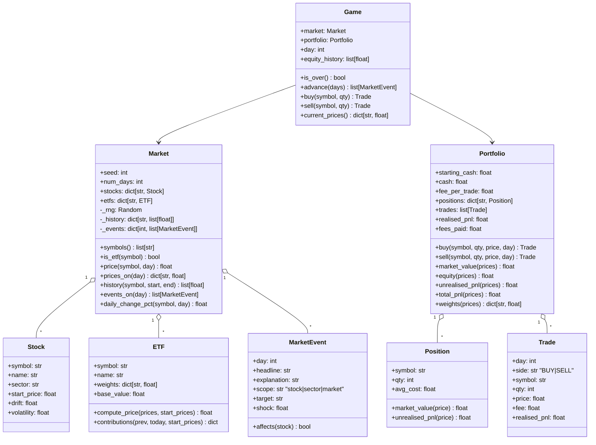

# 02 — Architecture

## 2.1 Tech stack

| Concern | Choice | Why |
|---|---|---|
| Language | Python 3.10+ | Course language; runs with `python3 main.py` |
| Terminal UI | [`rich`](https://rich.readthedocs.io) | Coloured tables, panels, green/red P&L — a much better 3-min demo for one dependency |
| Dashboard (Phase 5) | [`textual`](https://textual.textualize.io) | Same authors as rich. Tabs, buttons and mouse in the terminal; it displays our rich renderables directly, so `views.py` is reused (D-17) |
| Charts | Own ASCII/Unicode line chart in `cli/charts.py` | No extra dependency, and a small algorithm Quang can explain (scale values → rows) |
| AI sentiment (Phase 5) | TypeSafe **Jev** over HTTPS via stdlib `urllib.request` + `json` | No SDK dependency; only `tradesim/ai/` touches the network (D-19, D-20) |
| Randomness | `random.Random(seed)` | Reproducible markets (needed for replay, tests, demos) |
| Maths | `statistics` (`mean`, `stdev`), `math` | Standard library — evidences LO11 |
| Data files | JSON via `json` + `pathlib` | Stock universe, events, scenarios, save files — separates data from code |
| CLI args | `argparse` | `--seed`, `--days`, `--scenario` |
| Tests | `pytest` (+ `pytest-cov` optional) | Readable asserts, `approx` for floats |
| Packaging | none — plain folder with `requirements.txt` | Keep it simple |

`requirements.txt`: `rich>=13`, `textual>=1.0` · `requirements-dev.txt`: `pytest>=8`, `pytest-cov>=5`

## 2.2 Folder structure

```
trading-sim/
├── README.md
├── requirements.txt
├── requirements-dev.txt
├── main.py                      # entry point: parse args → cli.app.run()
├── data/
│   ├── universe.json            # stocks + ETFs (symbols, sectors, params, weights)
│   ├── events.json              # Phase 2: event catalogue (headline templates, shocks)
│   ├── sentiment_cache.json     # Phase 5: Jev labels keyed by headline text (committed, pre-warmed for the demo)
│   └── scenarios.json           # X-01: challenge scenarios
├── tools/
│   └── find_demo_seed.py        # search seeds for a dramatic demo market (see 06)
├── saves/                       # X-02: save files (git-ignored)
├── tradesim/
│   ├── __init__.py
│   ├── config.py                # ALL tunable constants
│   ├── loader.py                # read + validate data/*.json → Stock / ETF objects
│   ├── engine/                  # pure logic — NO print/input/rich
│   │   ├── errors.py            # custom exceptions
│   │   ├── stock.py             # class Stock
│   │   ├── etf.py               # class ETF (weighted-average pricing)
│   │   ├── events.py            # class MarketEvent + event generation (Phase 2)
│   │   ├── market.py            # class Market: generates & serves price history
│   │   ├── trade.py             # class Trade (one log entry)
│   │   ├── position.py          # class Position (qty + average cost)
│   │   ├── portfolio.py         # class Portfolio: cash, positions, buy/sell, P&L
│   │   ├── analytics.py         # pure functions: returns, volatility, drawdown…
│   │   └── game.py              # class Game: ties market + portfolio + clock
│   ├── education/               # original features — also NO print/input/rich
│   │   ├── diversification_lab.py   # E-01
│   │   ├── explainer.py             # E-02
│   │   ├── coach.py                 # E-03
│   │   ├── strategies.py            # E-04 preset strategies
│   │   ├── whatif.py                # E-04 replay engine
│   │   └── headline_lab.py          # E-05 keyword counter + scoring (gets the AI as a function argument)
│   ├── ai/                      # Phase 5 — the ONLY package that uses the network
│   │   └── sentiment.py         # Jev call + JSON cache + offline fallback
│   ├── extensions/              # X-01..X-03, only if time allows
│   │   ├── scenarios.py
│   │   └── storage.py
│   └── cli/                     # the ONLY layer that talks to the user
│       ├── app.py               # REPL loop + command dispatch (Phase 1; later `--plain`)
│       ├── tui.py               # Phase 5: Textual dashboard, reuses parser/views/charts
│       ├── parser.py            # text → Command, input validation
│       ├── views.py             # build rich Tables/Panels from engine data
│       └── charts.py            # ASCII line chart + sparkline
└── tests/
    ├── conftest.py              # shared fixtures (small fixed market, fresh portfolio)
    ├── test_loader.py
    ├── test_etf.py
    ├── test_market.py
    ├── test_portfolio.py
    ├── test_analytics.py
    ├── test_game.py
    ├── test_parser.py
    ├── test_charts.py
    ├── test_diversification_lab.py
    ├── test_explainer.py
    ├── test_coach.py
    ├── test_whatif.py
    ├── test_headline_lab.py     # fake classifier — no network
    └── test_sentiment.py        # cache + fallback, network mocked
```

## 2.3 Layers and dependency rule

```
          ┌──────────────────────────────────────────────┐
 user ⇄   │ cli/   app · parser · views · charts  (rich) │   only layer with print/input
          └───────────────┬──────────────────────────────┘
                          │ calls methods, catches TradeSimError
          ┌───────────────▼──────────────┐   ┌─────────────────────────────┐
          │ engine/game.py  (Game)       │◄──┤ education/  lab · explainer │
          └──────┬──────────────┬────────┘   │ coach · strategies · whatif │
                 │              │            └─────────────────────────────┘
        ┌────────▼─────┐  ┌─────▼────────┐        uses Market, Portfolio,
        │ Market       │  │ Portfolio    │        analytics (read-only)
        │ Stock · ETF  │  │ Position     │
        │ MarketEvent  │  │ Trade        │
        └──────────────┘  └──────────────┘
        config.py · loader.py · errors.py · analytics.py  (used by everything below cli)
```

**Rule:** arrows point *down* only. `engine` never imports `education` or `cli`;
`education` never imports `cli`. This makes every calculation testable without a terminal.

**AI rule (Phase 5):** `ai/sentiment.py` is the only module that touches the network or
`data/sentiment_cache.json`. `education/headline_lab.py` never imports it. `cli` passes
`sentiment.classify` *in* as a function argument, and tests pass a fake one. AI output
is display-only and never feeds `Market` (D-20).

```
 cli ──passes classify──► education/headline_lab.score(headlines, classify)
  │                                   ▲
  └──imports──► ai/sentiment.classify ┘   (cache hit → no network; no key/timeout → None)
```

## 2.4 Class design



Every class implements `__str__` (player-friendly) and `__repr__` (developer-friendly) —
both are taught in Week 7 and are easy demo talking points.

### Custom exceptions (`engine/errors.py`)

```
TradeSimError                      # base — CLI catches this one
├── UnknownSymbolError             # "XYZ is not a tradable symbol. Try: market"
├── InvalidQuantityError           # "Quantity must be a whole number > 0"
├── InsufficientCashError          # "Need $1,801.00, you have $950.00"
├── InsufficientSharesError        # "You hold 5 AAPL, can't sell 10"
├── GameOverError                  # "The game has ended. Type report or quit"
├── CommandError                   # raised by cli/parser.py: "Usage: buy SYMBOL QTY"
└── DataFileError                  # bad/missing JSON, weights not summing to 1, …
```

## 2.5 Key design decisions

1. **Pre-generated market.** `Market.__init__` generates the full price path for every
   stock for days `0..num_days` (and events) from the seed, then computes ETF prices from
   those. The player only *sees* up to `Game.day` (no peeking — `Game` never exposes
   future prices). Benefits: replay is trivial, the Lab can compare any window, and the
   market is independent of player actions (trades don't move prices).
2. **ETF has no randomness of its own.** Its price is 100% derived from its holdings, so
   diversification effects are genuine, not faked.
3. **Trades execute at the current day's price** (think "today's close") plus a flat fee.
4. **Average-cost accounting** for positions (simplest to explain; see §3.5).
5. **Equity snapshot** appended to `Game.equity_history` at day 0 and after each day
   advance → feeds charts, analytics, coach and what-if comparison.
6. **Strategies are plain functions** with one signature (§2.7) stored in a dict
   `STRATEGIES = {"Hold MIX6": hold_etf, ...}` — functions as values is a nice talking point.

## 2.6 Main loop and data flow

```
main.py ──► parse args (--seed, --days, --scenario, --plain)
         └► cli.app.run(args)        # Phase 5+: cli.tui.run(args) unless --plain
                                     # (the Textual app runs the same parse → handler → view
                                     #  steps from its command box, shown below for the REPL)
               │
               ├─ loader.load_universe("data/universe.json") ─► stocks, etfs
               ├─ Market(stocks, etfs, seed, days)            ─► full price history
               ├─ Game(market, Portfolio(STARTING_CASH, FEE_PER_TRADE))
               ├─ show banner + disclaimer + market table
               │
               └─ loop while not quit:
                     line = console.input("> ")
                     try:
                         cmd = parser.parse(line)      # may raise CommandError
                         result = HANDLERS[cmd.name](game, cmd.args)
                         console.print(views.render(result))
                     except TradeSimError as e:
                         console.print(f"[red]{e}[/red]")
                     if game.is_over(): show end report, offer whatif
```

`buy AAPL 10` sequence:

```
parser.parse ─► Command("buy", ["AAPL", "10"]) ─► validate: symbol upper-cased, qty int > 0
app handler  ─► game.buy("AAPL", 10)
game.buy     ─► price = market.price("AAPL", day) ─► portfolio.buy("AAPL", 10, price, day)
portfolio    ─► cost = qty*price + fee; if cost > cash: raise InsufficientCashError
             ─► cash -= cost; update Position avg cost; append Trade; return Trade
app          ─► views.trade_confirmation(trade) ; (Phase 3) coach.review_trade(...) tips
```

## 2.7 Interfaces for the education modules

```python
# diversification_lab.py
def compare(market: Market, stock_symbol: str, etf_symbol: str,
            start_day: int, end_day: int, amount: float) -> LabResult: ...
def monte_carlo(stocks, etfs, stock_symbol, etf_symbol,
                runs: int, days: int, loss_threshold: float) -> MonteCarloResult: ...

# explainer.py
def etf_move_breakdown(market: Market, etf_symbol: str, day: int) -> list[ContributionRow]: ...
def explain_event(market: Market, event: MarketEvent, etf_symbol: str) -> str: ...

# coach.py
class Tip:  rule_id, severity ("info"|"warn"), message
def review_trade(game: Game, trade: Trade) -> list[Tip]: ...
def review_session(game: Game) -> list[Tip]: ...

# strategies.py  — every strategy has this exact signature
Order = tuple[str, str, int]            # (side, symbol, qty)
def hold_etf(day: int, market: Market, portfolio: Portfolio) -> list[Order]: ...

# whatif.py
def replay(market: Market, strategy, end_day: int) -> ReplayResult: ...   # equity curve + stats
def compare_strategies(game: Game) -> list[ReplayResult]: ...           # incl. "Your trades"

# headline_lab.py  (E-05) — pure, no network
class Verdict:  label ("positive"|"negative"|"neutral"), confidence (0..1), source ("keywords"|"jev")
def keyword_verdict(headline: str) -> Verdict: ...        # counts words from data/events.json lists
def truth(event: MarketEvent) -> str: ...                 # sign of event.shock → "positive"/"negative"
def score(events: list[MarketEvent], classify) -> LabScore: ...   # rows + hits per source
#   classify(headline) -> Verdict | None   (None = AI unavailable → Jev column shows "—")

# ai/sentiment.py  (E-05) — the only network code
def classify(headline: str) -> Verdict | None: ...        # cache → Jev → None on any failure
```

Result objects (`LabResult`, `ReplayResult`, …) are small plain classes holding numbers
and lists only — `cli/views.py` turns them into tables/charts.

## 2.8 Configuration (`tradesim/config.py`)

```python
STARTING_CASH = 10_000.00
FEE_PER_TRADE = 1.00          # flat $ per buy/sell
GAME_DAYS = 60
MIN_PRICE = 1.00              # price floor
MAX_DAILY_MOVE = 0.30         # clamp any single-day return to ±30%
ETF_BASE_VALUE = 100.00
MARKET_VOL = 0.008            # common market factor (daily σ)
SECTOR_VOL = 0.010            # common sector factor (daily σ)
EVENT_PROBABILITY = 0.15      # chance of a news event per day (Phase 2)
EVENT_SEED_OFFSET = 1_000_003 # events use Random(seed + offset), independent of prices
SHORT_COLLATERAL = 1.5        # X-03 only
LAB_DEFAULT_AMOUNT = 5_000.00
MONTE_CARLO_RUNS = 200
CHART_HEIGHT = 12
CHART_WIDTH = 60
# coach thresholds
CONCENTRATION_LIMIT = 0.50
IDLE_CASH_LIMIT = 0.80
IDLE_CASH_GRACE_DAYS = 10
PANIC_DROP = 0.08
PANIC_WINDOW_DAYS = 2
OVERTRADE_PER_DAY = 5
FEE_SHARE_LIMIT = 0.25
GOOD_MAX_WEIGHT = 0.30        # "nicely diversified" praise threshold
# education features
LAB_MIN_DAYS = 5
MC_LOSS_THRESHOLD = -0.20     # "lost more than 20%" in Monte Carlo lab
DIP_TRIGGER = 0.02            # Buy-the-dip strategy: MIX6 daily fall that triggers a buy
DIP_TRANCHE = 0.20            # ... invests 20% of starting cash each time
DCA_INTERVAL_DAYS = 5
# Headline Lab (E-05)
JEV_API_KEY_ENV = "JEV_API_KEY"   # read with os.environ.get; never hard-code a key
JEV_TIMEOUT_S = 3                 # give up and fall back after 3 s
SENTIMENT_CACHE_PATH = "data/sentiment_cache.json"
NEUTRAL_BAND = 0.60               # confidence below this → shown as "neutral"
```
